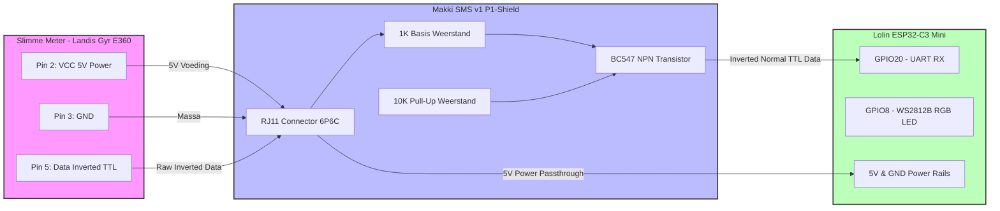

# Hardware & Opbouw: Makki's SMS v1 P1-Shield & Lolin ESP32-C3

Dit document beschrijft de hardware-architectuur, de benodigde componenten (BOM) en de stapsgewijze opbouw van het P1-meetstation op basis van een **Makki's SMS v1** printplaat en een **Lolin ESP32-C3 Mini**.

---

## 🏗️ Hoe de PCB is Opgezet (Architectuur)

De **Makki's SMS v1** PCB is ontworpen als een compact, niet-geïsoleerd P1-shield dat direct op (of onder) de microcontroller wordt geprikt. Omdat het P1-signaal van slimme meters (zoals de Landis+Gyr E360) geïnverteerd is en op TTL-niveau werkt, maakt het ontwerp gebruik van een eenvoudige en betrouwbare **BC547 transistor-schakeling** (ondersteund door een 1K en 10K weerstand) om het signaal fysiek te inverteren voordat het de RX-pin van de ESP32-C3 bereikt.

* **Voeding:** Het shield haalt 5V (of 3.3V) direct uit de P1-poort van de slimme meter (pin 2: *External Device Power*, afhankelijk van de meterversie) of via de USB-C poort tijdens het programmeren.
* **Status Indicatie:** Maakt gebruik van de onboard WS2812B RGB-LED van de Lolin ESP32-C3 Mini (aangesloten op **GPIO8**) voor visuele status- en vermogensindicatie.

### Visuele Signaalstroom

---

## 📦 Uitgebreide Componentenlijst (BOM)

| Component | Aantal | Omschrijving / Specificatie |
| :--- | :---: | :--- |
| **Makki's SMS v1 PCB** | 1 | De P1-shield printplaat |
| **Lolin ESP32-C3 Mini** | 1 | Microcontroller (voorzien van ESP-IDF en WS2812B LED op GPIO8) |
| **RJ11 Connector (6P4C / 6P6C)** | 1 | Haakse print-connector voor de P1-kabel |
| **BC547 Transistor** | 1 | NPN-transistor voor de signaalinversie van het P1-signaal |
| **1K Weerstand** | 1 | Weerstand voor de basis aansturing van de transistor |
| **10K Weerstand** | 1 | Pull-up weerstand voor de stabiele signaaloverdracht |
| **Pinheaders** | Set | Male/female headers om de ESP32-C3 op het shield te monteren |
| **P1-Kabel** | 1 | Standaard RJ11-kabel (6P4C) om te verbinden met de slimme meter |

---

## 🔌 Pinout & Aansluitingen

| Signaal / Functie | ESP32-C3 Pin | Aansluiting op Shield / Hardware |
| :--- | :--- | :--- |
| **UART RX** | `GPIO20` | Ontvangt het geïnverteerde P1-datasignaal van de BC547 transistor |
| **UART TX** | `GPIO21` | Gereserveerd / niet actief gebruikt voor P1 |
| **Status LED** | `GPIO8` | Onboard WS2812B RGB-LED (aangestuurd via RMT) |
| **GND** | `GND` | Gemeenschappelijke massa |
| **5V / VBUS** | `5V` | Voeding vanaf P1-poort of USB-C |

---

## 🛠️ Stapsgewijze Opbouwhandleiding

### Stap 1: Voorbereiding en visuele inspectie van de PCB
Leg alle componenten overzichtelijk klaar op een schone soldeerwerkplek. Inspecteer de Makki's SMS v1 printplaat aan beide kanten om te controleren of de printsporen onbeschadigd zijn en de soldeereilandjes schoon zijn.
* **Verificatie:** Alle printgaten zijn vrij van vuil of soldeerresten van de productie.

### Stap 2: Solderen van de 1K en 10K weerstanden
Begin met de laagste componenten op de printplaat. Plaats de **1K weerstand** en de **10K weerstand** op de daarvoor bestemde posities (raadpleeg de opdruk op de printplaat voor de exacte locaties van R1 en R2). Buig de aansluitdraden aan de onderkant iets om zodat ze op hun plek blijven zitten, soldeer ze vast aan de onderkant en knip de overtredende draadjes kort af.
* **Verificatie:** De weerstanden liggen plat op de printplaat en de soldeerverbindingen hebben een glanzend, kegelvormig uiterlijk zonder soldeerbrugjes.

### Stap 3: Solderen van de BC547 transistor
Plaats de **BC547 NPN-transistor** in de printplaat. Let hierbij goed op de oriëntatie: de ronde bolling/platte kant van de transistor moet exact overeenkomen met de halfronde afdruk op de silkscreen van de PCB. Steek de pootjes door, soldeer ze vast en knip de restjes af.
* **Verificatie:** De platte kant van de transistor wijst in de richting zoals aangegeven op de printplaat.

### Stap 4: Solderen van de RJ11 connector en pinheaders
Plaats de haakse **RJ11-connector** aan de rand van de printplaat en soldeer eerst één pin vast om te controleren of deze recht zit. Soldeer daarna de overige pinnen van de connector stevig vast. Plaats vervolgens de female pinheaders op de printplaat en zet ze tijdelijk vast (je kunt hiervoor eventueel de Lolin ESP32-C3 er even los in prikken zodat de headers perfect recht uitlijnen tijdens het solderen).
* **Verificatie:** De RJ11-connector zit stevig en haaks op de rand van de print, en de pinheaders staan kaarsrecht omhoog.

### Stap 5: Plaatsen van de Lolin ESP32-C3 Mini en eerste test
Klik de **Lolin ESP32-C3 Mini** voorzichtig in de gesoldeerde pinheaders. Let op dat de pinout correct aansluit (`GPIO20` voor RX en `GPIO8` voor de LED). Sluit het bordje tijdelijk aan op je computer via een USB-C kabel om de firmware te flashen.
* **Verificatie:** Na het flashen licht de onboard RGB-LED zacht wit op en is de webserver via het netwerk bereikbaar.