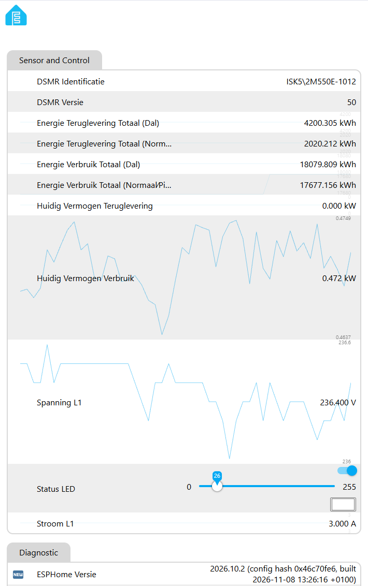
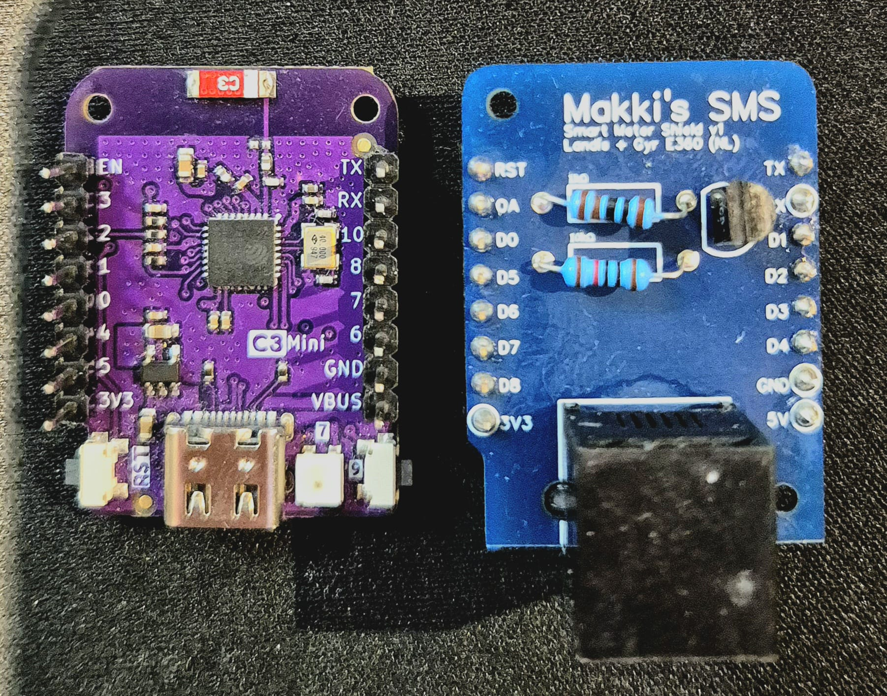

# P1 Meter ESPHome voor Lolin ESP32-C3 & Makki's SMS Shield

Een robuuste en zelfvoorzienende ESPHome-firmware voor de **Lolin ESP32-C3 Mini** in combinatie met het **Makki P1-shield (SMS v1)** om een **Landis+Gyr E360** (of vergelijkbare DSMR 5.0+) slimme meter uit te lezen.

Het P1-shield gebruikt de **LOLIN/Wemos D1 mini shield-layout**. Boards met die layout passen op dezelfde headers, maar zijn niet allemaal zonder firmwareaanpassingen uitwisselbaar:

* **[LOLIN C3 mini](https://docs.wemos.cc/en/latest/c3/c3_mini.html)** — aanbevolen; past op D1 mini-shields en is het board waarop deze configuratie is gebaseerd.
* **[LOLIN S2 mini](https://docs.wemos.cc/en/latest/s2/s2_mini.html)** — past ook op D1 mini-shields, maar vereist controle en mogelijk aanpassing van de UART-pinnen en LED-configuratie.
* **[LOLIN D1 mini](https://docs.wemos.cc/en/latest/d1/d1_mini.html)** en **[D1 mini Lite](https://docs.wemos.cc/en/latest/d1/d1_mini_lite.html)** — hebben de D1 mini-vormfactor, maar zijn ESP8266/ESP8285-boards. Deze ESP32-firmware werkt er niet ongewijzigd op.
* **D1 mini Pro** — geen directe vervanger: de print is langer dan de standaard D1 mini-layout.

Alleen de C3 mini is met de huidige configuratie direct bedoeld. Stel voor een ander ESP32-board `esp32.board` in op het juiste model en controleer of de shield-aansluitingen overeenkomen met de ingestelde UART-pinnen (`GPIO20` RX en `GPIO21` TX); pas zo nodig de `uart:`-sectie aan. Heeft het board geen WS2812B-led op GPIO8, verwijder dan in `makkis-sms.yaml` de volledige `light:`-sectie én de LED-aansturing (`on_value`-acties) bij `power_delivered` en `power_returned`; die acties verwijzen naar de LED en veroorzaken anders een configuratiefout.


## 📋 Inhoudsopgave

* [🚀 Belangrijke Features](#-belangrijke-features)
* [🛠️ Hardware & Pinout](#️-hardware--pinout)
* [⚙️ ESPHome Configuratie](#️-esphome-configuratie)
* [📊 LED Logica & Kleurenverloop](#-led-logica--kleurenverloop)
* [📥 Installatie & Snelle Start](#-installatie--snelle-start)
* [📚 Aanvullende Documentatie](#-aanvullende-documentatie)

## 🚀 Belangrijke Features

* **DSMR 5.0+ Ondersteuning**: Leest automatisch alle actuele verbruiks-, terugleverings- en tariefregisters uit (Normaal/Piek en Dal).
* **Dynamische Status-LED (WS2812B)**:
  * **Standby (~0W):** Subtiel zacht wit.
  * **Verbruik (Geel naar Rood):** Schaalt op basis van het vermogen tot een maximum van 8000W (ca. 35A op 1 fase).
  * **Teruglevering (Groen naar Blauw):** Schaalt op basis van zonne-opbrengst tot een maximum van 3680W (ca. 16A op 1 fase).
* **Anti-Flipperkast Filter**: Maakt gebruik van een *Exponential Moving Average* filter (`alpha: 0.2`) en een vloeiende transitie van 2 seconden om rustige overgangen te garanderen zonder wilde kleurwisselingen.
* **Lokale Webinterface (Versie 3)**: Volledig inzicht in alle meetwaarden, systeemstatus, IP-adres, Wi-Fi signaalsterkte, Uptime en ESPHome-versie. De status-LED is via de webserver ook handmatig te dimmen of uit te schakelen.
* **OTA (Over-The-Air) Updates**: Eenvoudig draadloos bij te werken na de eerste USB-flash.

### Voorbeeld van de webinterface

<p align="center">
  
</p>
<p align="center"><em>Voorbeeldweergave van de lokale ESPHome-webinterface.</em></p>

## 🛠️ Hardware & Pinout

### Hardware

<p align="center">
  
</p>
<p align="center"><em>Makki's SMS P1-shield naast de LOLIN C3 mini.</em></p>

De opstelling bestaat uit een **Lolin ESP32-C3 Mini** en het **Makki's SMS v1 P1-shield**. De P1-poort van de slimme meter levert seriële telegrammen; het shield verzorgt de signaalbewerking/inversie voor de UART-ingang van de ESP32. De ESP32 leest de telegrammen uit en publiceert de meetwaarden via ESPHome. De onboard WS2812B-led is aangesloten op GPIO8.

De P1-poort gebruikt een modulaire **6-posities connector (6P6C)**, meestal RJ12 genoemd. Een RJ11-stekker heeft vaak dezelfde breedte en past daardoor vaak in deze aansluiting, maar kan minder contacten hebben. Controleer of de kabel de contacten bevat die jouw meter en shield nodig hebben.

| Component | Pin / Aansluiting | Beschrijving |
| :--- | :--- | :--- |
| **Lolin ESP32-C3 Mini** | `GPIO8` | Onboard WS2812B RGB LED (aangestuurd via ESP-IDF RMT) |
| **UART RX** | `GPIO20` | Ontvangt data van het Makki P1-shield (inverteert het signaal via de boordtransistor) |
| **UART TX** | `GPIO21` | Niet actief gebruikt voor P1, gereserveerd voor busstructuur |
| **Voeding** | `5V / 3.3V` | Gevoed via het P1-shield of USB-C tijdens programmeren |

*Zie voor het volledige aansluitschema, de BOM (1K en 10K weerstanden) en het Mermaid-diagram de [hardware.md](hardware.md).*

## ⚙️ ESPHome Configuratie

De volledige ESPHome-firmware is te vinden in het bestand [`makkis-sms.yaml`](makkis-sms.yaml). 

Belangrijke configuratiedetails:
* **Framework:** ESP-IDF met `esp32_rmt_led_strip` driver voor de onboard LED op `GPIO8`.
* **DSMR:** Aangesloten op `GPIO20` (UART RX) op 115200 baud.
* **Webserver:** Geconfigureerd met `include_internal: true` voor weergave van netwerk- en systeeminformatie.

## 📊 LED Logica & Kleurenverloop

De onboard WS2812B RGB-LED op GPIO8 geeft direct visuele feedback:

* **Standby Mode (`P < 10W`)**: De LED brandt op 10% helderheid in een zachte witte kleur.
* **Verbruiksmodus (`P > 10W`)**: Helderheid schakelt naar 50%. Kleur verlopen van **Geel/Oranje** (laag verbruik) naar **Rood** (richting de 8000W limiet).
* **Teruglevermodus (`P > 10W`)**: Helderheid schakelt naar 50%. Kleur verlopen van **Groen** (lage zonne-opbrengst) naar **Blauw** (richting de 3680W limiet).

## 📥 Installatie & Snelle Start

1. **Secrets instellen**: Zorg dat `wifi_ssid` en `wifi_password` zijn gedefinieerd in je ESPHome `secrets.yaml`.
2. **Firmware Flashen**: Sluit de ESP32-C3 via USB-C aan en flash het bestand via het ESPHome Dashboard of met het CLI commando:
   ```bash
   esphome run makkis-sms.yaml
   ```
3. **P1-kabel aansluiten**: Sluit de P1-kabel aan op het Makki P1-shield. De P1-aansluiting is 6P6C (vaak RJ12 genoemd); een RJ11-stekker past vaak, maar kan minder contacten hebben. De LED zal na het opstarten zacht wit oplichten.
4. **Home Assistant**: Open Home Assistant; de P1-meter verschijnt automatisch bij de Ontdekte Integraties.

## 📚 Aanvullende Documentatie

* 📖 [**hardware.md**](hardware.md) — Bevat het uitgebreide onderdelenoverzicht (BOM met 1K/10K weerstanden), de stapsgewijze soldeerdocumentatie en het volledige **Mermaid-architectuurdiagram**.
* 📝 [**changelog.md**](changelog.md) — Bekijk alle releasedetails, versie-historie en toegevoegde functionaliteiten per versie.

## Licentie

Dit project is beschikbaar onder de **GNU General Public License v3.0**. Zie [LICENSE](LICENSE) voor de volledige licentievoorwaarden.